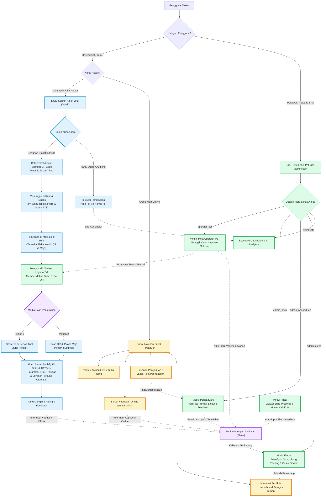

# PRODUCT REQUIREMENTS DOCUMENT (PRD)
## Sistem Terpadu Layanan Publik & Evaluasi Kinerja (Super-App PST)
**Instansi:** Badan Pusat Statistik (BPS) Provinsi Jawa Tengah  
**Lingkup Konsolidasi:** Integrasi 5 Sistem (`pst`, `statisfy`, `pristi`, `pengaduan.jateng.pro`, `elena`)  
**Tech Stack Utama:** Laravel 11/12 + FilamentPHP v3 + Livewire 3 + Tailwind CSS + MySQL 8.0 / MariaDB  
**Versi Dokumen:** 2.0 (Final Blueprint)  
**Tanggal:** 15 Oktober 2026  

---

## 1. Ringkasan Eksekutif & Latar Belakang

Saat ini, ekosistem pelayanan publik dan penilaian kinerja petugas Pelayanan Statistik Terpadu (PST) di BPS Provinsi Jawa Tengah berjalan di atas **5 aplikasi terpisah** dengan *database* dan *framework* yang terfragmentasi:
1. **PST (`pst`):** Aplikasi antrian lobi, buku tamu, dan loket pelayanan berbasis CodeIgniter 3.1.11 (`pst_db.sql` - 6 tabel).
2. **Statisfy (`statisfy`):** Aplikasi Survei Kepuasan Masyarakat (SKM) & analisis AI berbasis CodeIgniter 4.x (`statisfy.sql` - 6 tabel).
3. **Pristi (`pristi`):** Aplikasi jadwal jaga petugas PST, presensi, dan laporan Monev Kab/Kota berbasis CodeIgniter 3.1.11 (`pristi_db_new (2).sql` - 6 tabel).
4. **Pengaduan (`pengaduan.jateng.pro`):** Sistem pengelolaan pengaduan masyarakat & *whistleblowing* berbasis CodeIgniter 3.1.11 (`pengaduan_jateng.sql` - 2 tabel).
5. **Elena (`elena`):** Sistem evaluasi kinerja bulanan dan pemilihan petugas terbaik berbasis CodeIgniter 3.1.11 (`jatengwe_apps.sql` - 8 tabel).

### 1.1. Masalah Utama pada Arsitektur Lama
* **Silo Database & Rekapitulasi Manual:** Tabel penilaian di `elena` (`elena_t_kehadiran`, `elena_t_kepuasan`, `elena_t_layanan`) berdiri sendiri dan tidak terhubung ke database `pristi`, `statisfy`, maupun `pst`. Akibatnya, admin harus mengunduh dan mengunggah ulang file Excel setiap bulan melalui fungsi `importhadir`, `importlayanan`, dan `importkepuasan`.
* **Inkonsistensi Kunci Relasi Pegawai:** Sebagian tabel transaksi mencatat petugas menggunakan teks `nama_pegawai` (`varchar(50)`) atau `created_by` (`varchar(64)`), bukan menggunakan `nipbaru` (`char(18)`), sehingga rawan gagal *join* akibat perbedaan penulisan gelar.
* **Redundansi Fitur & Tabel:**
  * Data master pegawai terduplikasi di 5 tabel berbeda (`dash_pegawai`, `elena_m_petugas`, `presensi_m_pegawai`, `t_pengaduan_admin`, `skm_petugas_pst`).
  * Fitur survei kepuasan tercatat ganda di `pst_penilaian`, `skm_kepuasan`, `skm_survei`, dan `elena_t_kepuasan`.
  * Fitur pengaduan terpecah di aplikasi `pengaduan.jateng.pro` (`t_pengaduan`) dan modul internal `pristi` (`kandani_t_pengaduan`).
* **Friksi Pengalaman Pengguna (UX):** Pengunjung lobi harus mengisi ulang data layanan/petugas saat mengisi survei kepuasan, sementara pegawai internal harus login ke banyak URL berbeda sesuai perannya.

### 1.2. Tujuan Konsolidasi (Target State)
Menggabungkan kelima sistem menjadi **1 Aplikasi Monolitik Modular berbasis Laravel 11/12** dengan **1 Database Terpusat (`Single Source of Truth`)**, **1 Portal Publik**, dan **1 Pintu Login Pegawai (SSO RBAC)** yang mengotomatiskan seluruh aliran data dari penjadwalan petugas hingga pencetakan sertifikat petugas terbaik.

---

## 2. Spesifikasi Tech Stack & Arsitektur

| Komponen | Teknologi / Package | Kegunaan Utama |
| :--- | :--- | :--- |
| **Backend Framework** | **Laravel 11 / 12 (PHP 8.3+)** | Arsitektur utama, Eloquent ORM, *Service Container*, *Job Queue*, dan *REST/Web Routing*. |
| **Admin & Backoffice UI** | **FilamentPHP v3.2+** | Panel kerja internal (`/admin`) untuk Operator Loket, Admin Pristi, Admin Pengaduan, Tim Penilai Elena, dan Dashboard Eksekutif. |
| **Public Interactive UI** | **Livewire v3 + Alpine.js** | Antarmuka reaktif tanpa *reload* untuk Kiosk Lobi (`/kiosk`), TV Antrian (`/antrian`), Survei QR 15 Detik (`/s/{token}`), dan Portal Publik (`/`). |
| **Styling Framework** | **Tailwind CSS v3.4+** | Desain antarmuka modern dan responsif di layar sentuh Kiosk, TV Widescreen, maupun *smartphone* pengunjung. |
| **Database Engine** | **MySQL 8.0 / MariaDB** | Penyimpanan relasional terpusat dengan *Foreign Key Constraint* berbasis `users.id` dan `users.nip_baru`. |
| **Real-Time Engine** | **Laravel Reverb (WebSocket)** | Komunikasi *real-time* dua arah untuk panggilan layar TV ruang tunggu dan aktivasi instan sesi QR Plakat Meja Loket. |
| **Auth & Role Management** | **`spatie/laravel-permission` + `Filament Shield`** | Manajemen *Single Sign-On* (SSO) dan pembagian hak akses multi-role per pegawai. |
| **Excel Processing** | **`maatwebsite/laravel-excel`** | Menangani seluruh kebutuhan *import* jadwal dan *export* laporan bulanan/triwulanan/semesteran. |
| **PDF & Certificate** | **`setasign/fpdf` & `barryvdh/laravel-dompdf`** | Mencetak piagam penghargaan petugas terbaik dan laporan evaluasi dengan mempertahankan presisi layout `Sertifikat.php` & `LaporanFpdf.php`. |
| **QR Code Engine** | **`simplesoftwareio/simple-qrcode`** | Membuat QR dinamis pada struk tiket termal dan QR statis untuk plakat akrilik meja loket. |
| **AI Summary Engine** | **Gemini API / OpenAI PHP SDK** | Merangkum sentimen dan ulasan kualitatif pengunjung secara otomatis (mengadopsi fitur `skm_analisis_ai`). |

---

## 3. Arsitektur Hak Akses Pengguna (SSO & Multi-Role RBAC)

Seluruh pegawai login melalui `/admin/login` menggunakan NIP/Email dan mendapatkan tampilan menu yang menyesuaikan kombinasi *role* masing-masing:

| Role Sistem | Aktor Pengguna | Hak Akses Modul & Kewenangan |
| :--- | :--- | :--- |
| **`super_admin`** | Tim IT / Administrator | Akses penuh seluruh modul, manajemen master pegawai (`users`), konfigurasi loket, pengaturan tema (`system_settings`), dan log audit. |
| **`operator_pst`** | Petugas Pelayanan PST | Membuka Konsol Meja Loket (panggil antrian, catat layanan, klik selesai), *check-in* presensi harian, pengajuan tukar jaga, dan melihat nilai pribadi. |
| **`admin_pristi`** | Pengelola Jadwal & Monev | Mengelola kalender jadwal *shift* petugas, validasi presensi, input/evaluasi Monev Kab/Kota (`adm`, `teknis`, `sdm`, `korupsi`, dll.), serta ekspor laporan. |
| **`admin_pengaduan`** | Tim Penanganan Aduan | Memverifikasi tiket aduan masyarakat, mengisi tindak lanjut internal, membalas feedback publik, dan menautkan komplain valid ke petugas terkait. |
| **`admin_elena`** | Tim Penilai SDM | Menjalankan sinkronisasi skor otomatis bulanan, menginput nilai kualitatif (`kerjasama`, `inovatifkreatif`, `penampilan`), mengunci peringkat (`kuncihasil`), dan mencetak sertifikat PDF. |
| **`eksekutif`** | Kepala BPS / Pimpinan | Mengakses *Executive Dashboard* (statistik kunjungan PST, IKM *real-time*, rangkuman AI *Statisfy*, rekap kehadiran *Pristi*, dan *Leaderboard* petugas). |

---

## 4. Diagram Alur Sistem End-to-End

---

## 5. Kebutuhan Fungsional Detail per Modul (Functional Requirements)

### 5.1. Modul Kiosk Lobi, Antrian TV & Konsol Loket (Eks-`pst`)
* **FR-PST-01 (Kiosk Pengambilan Tiket & QR Dinamis):**
  * Menyediakan 4 tombol layanan sesuai skema eksisting: `perpustakaan`, `konsultasi`, `pembelian`, dan `rekomendasi`.
  * Setiap klik menghasilkan nomor urut harian (`queue_code`), membuat token unik (`qr_token`), menyimpan baris ke `pst_service_tickets` dengan status `waiting`, dan mencetak struk termal yang memuat QR Code menuju `/s/{qr_token}`.
* **FR-PST-02 (Buku Tamu Digital Auto-Complete):**
  * Mengadopsi fungsi `M_tamu::get_by_hp`: pengunjung memasukkan nomor HP/WhatsApp. Jika sudah terdaftar di `pst_visitors`, data `name`, `institution`, dan `address` otomatis terisi.
  * Mencatat waktu masuk (`check_in_at`) dan menyediakan daftar tamu aktif hari ini untuk menekan tombol **Pulang** (`check_out_at`).
* **FR-PST-03 (TV Ruang Tunggu Berbasis WebSocket):**
  * Menampilkan kartu antrian aktif per loket secara *real-time* menggunakan *Laravel Reverb* dan menyuarakan panggilan otomatis (contoh: *"Nomor antrian A-005, silakan menuju Loket 2"*).
* **FR-PST-04 (Konsol Operator 1-Layar):**
  * Menggabungkan proses registrasi (`pst_register`) dan pencatatan layanan (`pst_layanan`) ke dalam satu layar kerja.
  * Fitur tombol aksi: **Panggil**, **Panggil Ulang**, **Mulai Layanan** (`started_at`), **Sisip Antrian** (mengakomodasi `Operator::sisip`), **Lewati**, dan **Selesai Layanan** (`finished_at`).
  * Saat melayani, operator mengisi `visitor_name`, status kunjungan pertama (`is_first_visit`), rincian permintaan (`request_detail`), dan laporan penyelesaian (`service_report`).

### 5.2. Modul Survei Kepuasan 15 Detik & Analisis AI (Eks-`statisfy`)
* **FR-STA-01 (Scan QR Kertas Struk - Direct Binding):**
  * Membuka `/s/{qr_token}` di HP pengunjung akan langsung menampilkan foto & nama petugas (`served_by_user_id`), nomor loket, dan jenis layanan dari tiket terkait.
* **FR-STA-02 (Scan QR Plakat Akrilik Meja - Smart Session Binding):**
  * Membuka `/loket/{counter_id}/survei` akan mencari transaksi terakhir di meja tersebut yang berstatus `completed` atau `serving` dalam 15 menit terakhir dan belum memiliki survei.
* **FR-STA-03 (Micro-Survey 15 Detik & Anti-Spam):**
  * Pengunjung cukup memilih rating bintang/emotikon (`rating_score` 1–4 atau 1–5) dan menulis `feedback_comment` opsional.
  * Satu `service_ticket_id` hanya dapat mengirimkan 1 survei (terkunci otomatis setelah *submit*).
* **FR-STA-04 (Survei Online & Dashboard Analitik AI):**
  * Menyediakan form `/survei-online` untuk layanan non-tatap muka (WhatsApp, Web, Email).
  * Menyediakan fitur **AI Executive Summary (`statisfy_ai_analyses`)** dengan mode `bulanan`, `tahunan`, dan `alltime` serta ekspor peringkat kepuasan petugas (`exportRank`, `exportDetail`).

### 5.3. Modul Jadwal Shift, Presensi & Monev Kab/Kota (Eks-`pristi`)
* **FR-PRI-01 (Kalender Jadwal & Tukar Shift):**
  * Admin menyusun jadwal jaga petugas per sesi/loket melalui kalender interaktif atau mengimpor via template Excel (`import`, `importperubahan`).
* **FR-PRI-02 (Integrasi Presensi Jaga):**
  * Mencatat kehadiran petugas (`check_in_time`, `check_out_time`, dan kalkulasi keterlambatan `time_difference`) baik secara otomatis saat petugas aktif di Konsol Loket, input mandiri, maupun *upload* log mesin presensi.
* **FR-PRI-03 (Monev & Rekapitulasi Kabupaten/Kota):**
  * Mengelola penilaian lintas Kabupaten/Kota untuk dimensi `adm` (`pelayanan_admin`), `teknis`, `sdm`, `korupsi`, `prof`, `sarpras`, `sipp`, `pengaduan`, dan `inovasi`.
  * Menghasilkan laporan Excel terformat untuk periode **Bulanan**, **Triwulanan**, dan **Semesteran**.

### 5.4. Modul Layanan Pengaduan & Aspirasi (Eks-`pengaduan.jateng.pro` & `pristi`)
* **FR-ADU-01 (Tiket Pengaduan Publik & Tracking):**
  * Masyarakat mengirim aduan (`reporter_name`, `reporter_email`, `reporter_phone`, `complaint_category`, `complaint_content`) dan menerima `tracking_code` unik untuk memantau progres penyelesaian.
* **FR-ADU-02 (Disposisi Internal & Integrasi Penalti Elena):**
  * Admin memverifikasi aduan, mencatat `internal_follow_up` (tindak lanjut internal), dan mempublikasikan `public_feedback` (balasan resmi).
  * Jika aduan merupakan keluhan valid terhadap petugas PST tertentu, admin dapat mengisi `related_user_id` dan mencentang `is_valid_penalty = true` agar otomatis terhitung sebagai pengurang nilai di modul Elena.

### 5.5. Modul Engine Evaluasi Kinerja & Sertifikat (Eks-`elena`)
* **FR-ELE-01 (Auto-Sync Variabel Operasional):**
  * Menghilangkan kebutuhan *import* Excel manual untuk data kehadiran, jumlah layanan, dan kepuasan.
  * Sistem menarik data secara langsung berdasarkan `user_id` pada periode bulan/tahun yang dipilih:
    1. **Volume Layanan:** `COUNT` tiket `completed` dari `pst_service_tickets`.
    2. **Skor Kehadiran:** Akumulasi ketepatan waktu dari `pristi_attendances`.
    3. **Skor Kepuasan:** Rata-rata `rating_score` dan jumlah responden dari `statisfy_surveys`.
    4. **Jumlah Komplain:** `COUNT` aduan valid dari `public_complaints`.
* **FR-ELE-02 (Input Kualitatif & Kalkulasi Tertimbang):**
  * Tim Penilai menginput nilai `raw_cooperation_score` (`skp_perilaku`), `raw_innovation_score` (`inovatifkreatif`), dan `raw_appearance_score` (`penampilan`).
  * Sistem menghitung nilai tertimbang (`_ttb`), `total_score`, dan `eval_score` sesuai rumus tim (`elena_calc_code`).
* **FR-ELE-03 (Kunci Hasil, Leaderboard & Cetak Piagam PDF):**
  * Tombol **Kunci Hasil (`is_locked`)** mempublikasikan Petugas Terbaik ke halaman depan Portal Publik dan membuka akses unduh **Sertifikat Penghargaan PDF** serta **Laporan Evaluasi PDF/Excel**.

---

## 6. Desain Skema Database Terpadu (12 Tabel Inti)

| No | Nama Tabel Baru | Peleburan dari Tabel Lama | Kolom Kunci & Relasi Utama |
| :- | :--- | :--- | :--- |
| 1 | **`users`** | `dash_pegawai`, `elena_m_petugas`, `presensi_m_pegawai`, `presensi_m_user`, `t_pengaduan_admin`, `skm_petugas_pst` | `id` (PK), `nip_baru` (UK, `char(18)`), `nip_lama`, `name`, `name_without_title`, `email`, `whatsapp_number`, `region_code`, `unit_code`, `unit_name`, `echelon_id`, `elena_team_code`, `elena_calc_code`, `is_active` |
| 2 | **`pst_counters`** | *(Tabel Master Baru)* | `id` (PK), `counter_name`, `static_qr_slug` (UK), `active_operator_id` (FK `users`), `is_open` |
| 3 | **`pst_visitors`** | `pst_buku_tamu` | `id` (PK), `phone_number` (UK), `name`, `email`, `institution`, `address` |
| 4 | **`pst_visitor_logs`** | `pst_kunjungan_tamu` | `id` (PK), `visitor_id` (FK `pst_visitors`), `visit_date`, `purpose`, `check_in_at`, `check_out_at` |
| 5 | **`pst_service_tickets`** | `pst_tiket`, `pst_register`, `pst_layanan`, `elena_t_layanan` | `id` (PK), `qr_token` (UK), `service_date`, `queue_number`, `queue_code`, `service_type`, `visitor_id` (FK), `visitor_name`, `is_first_visit`, `counter_id` (FK), `served_by_user_id` (FK `users`), `request_detail`, `service_report`, `status`, `called_at`, `started_at`, `finished_at` |
| 6 | **`statisfy_surveys`** | `skm_survei`, `skm_kepuasan`, `pst_penilaian`, `elena_t_kepuasan` | `id` (PK), `service_ticket_id` (FK, Unique Nullable), `rated_user_id` (FK `users`), `counter_id` (FK), `survey_date`, `respondent_name`, `respondent_email`, `respondent_phone`, `service_type`, `media_channel`, `rating_score`, `feedback_comment`, `remote_ip` |
| 7 | **`statisfy_ai_analyses`** | `skm_analisis_ai` | `id` (PK), `mode` (`bulanan`, `tahunan`, `alltime`), `period_month`, `period_year`, `analysis_result` (JSON/Text), `created_at` |
| 8 | **`pristi_schedules`** | `presensi_m_jadwal`, `presensi_t_jadwal` | `id` (PK), `user_id` (FK `users`), `counter_id` (FK), `schedule_date`, `day_name`, `shift_name`, `swapped_with_user_id` (FK) |
| 9 | **`pristi_attendances`** | `presensi_t_transaksi`, `elena_t_kehadiran` | `id` (PK), `schedule_id` (FK), `user_id` (FK `users`), `attendance_date`, `check_in_time`, `check_out_time`, `time_difference`, `source`, `status` |
| 10 | **`pristi_monev_reports`** | Tabel transaksi Monev di `pristi` | `id` (PK), `region_code`, `period_year`, `period_type` (`bulan`, `triwulan`, `semester`), `period_value`, `score_adm`, `score_teknis`, `score_sdm`, `score_korupsi`, `score_prof`, `score_sarpras`, `score_sipp`, `score_pengaduan`, `score_inovasi` |
| 11 | **`public_complaints`** | `t_pengaduan`, `kandani_t_pengaduan` | `id` (PK), `tracking_code` (UK), `reporter_name`, `reporter_email`, `reporter_phone`, `complaint_category`, `complaint_content`, `public_feedback`, `internal_follow_up`, `related_user_id` (FK `users`), `is_valid_penalty`, `status`, `remote_ip` |
| 12 | **`elena_evaluations`** | `elena_t_lk`, `elena_t_kinerja`, `elena_t_kerjasama` | `id` (PK), `user_id` (FK `users`), `period_year`, `period_month`, `total_services_count`, `total_surveys_count`, `raw_satisfaction_avg`, `raw_performance_score`, `raw_attendance_score`, `raw_cooperation_score`, `raw_innovation_score`, `raw_appearance_score`, `raw_complaint_count`, `weighted_performance`, `weighted_attendance`, `weighted_cooperation`, `weighted_innovation`, `weighted_appearance`, `weighted_complaint`, `total_score`, `eval_score`, `rank_position`, `is_locked` |

*(Ditambah tabel sistem standar Laravel: `roles`, `permissions`, `model_has_roles`, `jobs`, dan `system_settings`).*

---

## 7. Pembagian Beban Kerja (Backend vs. Frontend) & Roadmap Eksekusi

### 7.1. Estimasi Proporsi Kompleksitas
* **Backend Engineering (70% Beban Kerja):**
  * Pembuatan skema *database migration* dan skrip ETL (*Extract, Transform, Load*) untuk menyatukan 5 file `.sql` lama dan memetakan relasi `nama_pegawai` ke `nip_baru`.
  * Pembangunan *Service Classes* untuk perhitungan otomatis Elena (`ElenaCalculationService`), logika *auto-bind* QR Plakat Meja, *WebSocket Event Broadcasting*, dan konversi laporan Excel/PDF.
  * Konfigurasi *Filament Resources*, *Custom Pages*, dan *Role Policy*.
* **Frontend Engineering (30% Beban Kerja):**
  * Pembuatan 4 antarmuka publik berbasis **Livewire + Tailwind CSS**: Kiosk Lobi Sentuh (`/kiosk`), Layar TV Antrian (`/antrian`), Micro-Survey 15 Detik di HP (`/s/{token}`), dan Portal Publik (`/`).
  * Integrasi *Web Speech API* untuk suara panggilan antrian di layar TV dan penyesuaian CSS cetak struk termal (`@media print`).

### 7.2. Tahapan Pengerjaan (6 Minggu)
1. **Minggu 1 — Core Foundation, Database & Legacy Data Migration:**
   * Setup Laravel 11/12, FilamentPHP v3, Livewire 3, dan Spatie Permission.
   * Eksekusi migrasi 12 tabel inti dan jalankan *Artisan Command* untuk mengimpor serta menormalisasi data pegawai dari `dash_pegawai`, `elena_m_petugas`, dan `skm_petugas_pst`.
2. **Minggu 2 — Modul Operasional PST (Kiosk, TV Reverb & Konsol Loket):**
   * Bangun halaman `/kiosk` (Tiket QR + Buku Tamu), `/antrian` (TV WebSocket + TTS), dan halaman Filament `OperatorConsole`.
3. **Minggu 3 — Modul Statisfy (15-Second QR Survey & AI Analytics):**
   * Bangun logika *Dual-Scan QR* (`/s/{qr_token}` dan `/loket/{id}/survei`), dashboard grafik kepuasan, dan integrasi API Analisis AI.
4. **Minggu 4 — Modul Pristi (Kalender Shift, Presensi & Monev Kab/Kota):**
   * Bangun manajemen kalender *shift* jaga, pencatatan presensi otomatis/manual, serta modul penilaian & ekspor Excel Monev Kab/Kota.
5. **Minggu 5 — Modul Pengaduan & Otomatisasi Engine Elena:**
   * Bangun portal & *backoffice* pengaduan masyarakat, lanjutkan dengan halaman `ElenaEvaluationMatrix` (auto-sync skor PST + Pristi + Statisfy + Pengaduan) dan cetak sertifikat PDF.
6. **Minggu 6 — Executive Dashboard, UAT & Cut-Over Deployment:**
   * Finalisasi *Executive Dashboard* pimpinan, pengujian beban (*load testing*), simulasi operasional di lobi PST BPS Jateng, dan *go-live*.