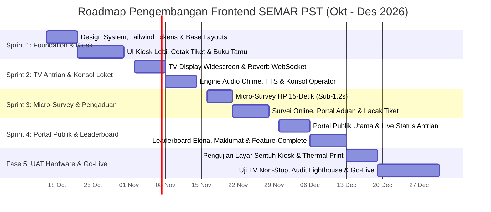

# ROADMAP & FRONTEND KANBAN BACKLOG
## SEMAR PST - Eksekusi Teknis Frontend Engineer
**Instansi:** Badan Pusat Statistik (BPS) Provinsi Jawa Tengah  
**Periode Pengerjaan:** 16 Oktober 2026 - 31 Desember 2026 (11 Minggu)  
**Target Feature-Complete (Lebih Cepat):** 12 Desember 2026 (8,5 Minggu Pengembangan Aktif)  
**Target UAT, Hardware Testing & Go-Live Buffer:** 13 Desember - 31 Desember 2026 (2,5 Minggu Stabilisasi)  
**Tech Stack Utama:** Livewire 3 + Alpine.js + Tailwind CSS v3.4 + Laravel Echo (Reverb WebSocket) + Web Speech API  
**Proporsi Beban Kerja:** Frontend 30% (Kiosk, TV Display, Mobile Survey, Portal Publik, Konsol Loket) | Backend 70%  

---

## 1. Roadmap Mingguan Frontend (16 Oktober - 31 Desember 2026)

### Matriks Target Milestone Frontend

| Sprint / Fase | Rentang Waktu | Fokus Milestone Frontend | Deliverable Utama Frontend |
| :--- | :--- | :--- | :--- |
| **Sprint 1** | **16 Okt - 31 Okt 2026** | Pondasi UI Tailwind, Shared Layouts, & Modul Kiosk Lobi Sentuh. | • Design system, color tokens BPS, typography, & atomic components. • Halaman Kiosk Lobi sentuh (`/kiosk`) dengan 4 tombol layanan. • Modal Buku Tamu Digital auto-lookup & layout cetak struk termal (`@media print`). |
| **Sprint 2** | **2 Nov - 13 Nov 2026** | Layar TV Antrian Lobi, WebSocket Reverb, Suara TTS, & Konsol Meja Loket. | • Halaman TV Ruang Tunggu Widescreen 16:9 (`/antrian`). • Integrasi Laravel Echo + Audio Chime + Web Speech API (suara Indonesia). • Konsol Meja Operator 1-layar kerja (`/admin/operator-console`). |
| **Sprint 3** | **16 Nov - 27 Nov 2026** | Micro-Survey HP 15-Detik (Dual-QR), Form Aduan & Pelacakan Tiket. | • UI Micro-Survey mobile ultra-cepat (`/s/{token}` & `/loket/{slug}/survei`). • Form Survei Online (`/survei-online`). • Portal Layanan Pengaduan (`/pengaduan`) & pelacakan status (`/pengaduan/lacak`). |
| **Sprint 4** | **30 Nov - 12 Des 2026** | Portal Publik Terpadu, Leaderboard Petugas Elena, & **100% Feature-Complete**. | • Halaman Beranda Publik (`/`) responsif desktop & mobile. • Widget live queue monitoring & profil loket PST. • Showcase Leaderboard Petugas Terbaik & maklumat pelayanan BPS. |
| **Fase 5** | **13 Des - 31 Des 2026** | UAT Hardware Lobi (Kiosk, TV, Thermal Printer), Audit Performa, & Go-Live. | • Uji coba fisik layar sentuh kiosk dan reliabilitas thermal printer 58/80mm. • Uji ketahanan TV display 8 jam kerja tanpa memory leak. • Audit Lighthouse (Performance >= 95, Sub-1.2s) & sinkronisasi go-live. |

---

## 2. Kanban Backlog - Frontend Engineering (25 Tiket Terukur)

**Keterangan Estimasi Story Points (SP):**  
`1 SP` = +- 2-3 Jam | `2 SP` = +- 1 Hari | `3 SP` = +- 1,5-2 Hari | `5 SP` = +- 3 Hari | `8 SP` = +- 4-5 Hari.

---

### EPIC 1: UI Foundation, Design System & Kiosk Lobi Fisik (16 Okt - 31 Okt 2026)
*Target: Menyiapkan fondasi antarmuka modern, responsif, dan ramah layar sentuh untuk pengunjung lobi PST.*

| ID Tiket | Nama Task Frontend | Prioritas | SP | Kriteria Selesai (Definition of Done) | Relasi BE |
| :--- | :--- | :---: | :-: | :--- | :---: |
| **FE-01** | Setup Tailwind Tokens & Base Blade Layouts | `P0 - Critical` | 2 | Setup konfigurasi Tailwind CSS dengan palet resmi BPS (Deep Navy `#002C5F`, Vibrant Orange `#F58220`, Emerald Green `#10B981`), font Inter/Plus Jakarta Sans, dan 4 layout dasar: `layouts.public`, `layouts.kiosk`, `layouts.display-tv`, dan `layouts.mobile-survey`. | BE-01 |
| **FE-02** | UI Layar Sentuh Kiosk Pengambilan Tiket (`/kiosk`) | `P0 - Critical` | 3 | Buat antarmuka sentuh resolusi 1080p/720p dengan 4 tombol kategori besar (`Perpustakaan`, `Konsultasi Statistik`, `Pembelian Produk`, `Rekomendasi Statistik`), haptic/active visual feedback, animasi tap, dan jam/tanggal real-time. | BE-09 |
| **FE-03** | Modal Interaktif Buku Tamu Digital Auto-Complete | `P0 - Critical` | 3 | Buat modal input nomor HP/WhatsApp dengan keyboard sentuh angka besar (on-screen keypad), auto-fill otomatis nama/instansi/alamat bila sudah terdaftar di `pst_visitors`, form pengisian tujuan dinas, dan tombol Check-In. | BE-10 |
| **FE-04** | Tab Tamu Aktif & Tombol Cepat Check-Out di Kiosk | `P1 - High` | 2 | Buat daftar tamu yang sedang berkunjung hari ini pada antarmuka Kiosk, pencarian cepat nama/HP, dan tombol 1-klik untuk menyelesaikan kunjungan (`check_out_at`). | BE-10 |
| **FE-05** | Template & Styling Cetak Struk Termal (`@media print`) | `P0 - Critical` | 2 | Buat styling cetak CSS khusus kertas thermal 58mm dan 80mm: logo BPS monokrom tajam, kode nomor antrian besar (`A-001`), tanggal/jam, QR Code dinamis (`/s/{qr_token}`), teks petunjuk scan, dan auto-trigger print dialog tanpa dialog browser mengganggu. | BE-09 |

---

### EPIC 2: TV Antrian Widescreen, Suara TTS & Konsol Meja Loket (2 Nov - 13 Nov 2026)
*Target: Menampilkan antrian real-time di layar TV ruang tunggu dan menyediakan konsol kerja 1-layar bagi petugas meja loket.*

| ID Tiket | Nama Task Frontend | Prioritas | SP | Kriteria Selesai (Definition of Done) | Relasi BE |
| :--- | :--- | :---: | :-: | :--- | :---: |
| **FE-06** | Layout Widescreen TV Display 16:9 (`/antrian`) | `P0 - Critical` | 3 | Buat antarmuka TV ruang tunggu rasio 16:9 ber-resolusi Full HD (1920x1080) dengan header identitas BPS Jateng, panel kartu loket aktif, panel antrian terlewat, dan area video/banner edukasi statistik. | BE-11 |
| **FE-07** | Integrasi WebSocket Client (Laravel Echo Reverb) di TV | `P0 - Critical` | 3 | Pasang listener Laravel Echo pada channel `queue-display`. Kartu loket otomatis beranimasi flash/pulse warna emas saat ada panggilan baru, berpindah state nomor tanpa me-refresh halaman browser. | BE-11 |
| **FE-08** | Audio Chime Ding-Dong & Web Speech API Speech Synthesis | `P0 - Critical` | 3 | Integrasikan pemutaran file audio ding-dong dilanjutkan pelafalan suara otomatis Bahasa Indonesia (*"Nomor antrian A-005, silakan menuju Loket 2"*). Sertakan *audio queue manager* agar panggilan tidak saling bertabrakan saat 2 loket memanggil bersamaan. | BE-11 |
| **FE-09** | Ticker Running Text Berita & Maklumat Pelayanan di TV | `P2 - Medium` | 1 | Buat komponen running text halus di bagian bawah layar TV yang menampilkan maklumat pelayanan BPS, jam operasional, dan indeks kepuasan masyarakat bulan berjalan. | BE-11 |
| **FE-10** | UI Konsol Operator Meja Loket (1-Screen Workflow) | `P0 - Critical` | 5 | Buat antarmuka kerja 1-layar bagi petugas loket di `/admin/operator-console`: kartu status antrian saat ini, tombol besar **Panggil**, **Panggil Ulang**, **Mulai Layanan**, **Selesai Layanan**, dan **Lewati**. | BE-12 |
| **FE-11** | Panel Registrasi & Pencatatan Layanan Cepat di Konsol | `P1 - High` | 3 | Buat panel formulir dalam konsol loket untuk mencatat `visitor_name`, status kunjungan pertama (`is_first_visit`), rincian kebutuhan tamu (`request_detail`), dan resume tindak lanjut (`service_report`) dengan autosave draft. | BE-12 |
| **FE-12** | Modal Sisip Antrian Prioritas/Manual di Konsol Loket | `P2 - Medium` | 2 | Buat dialog modal pada konsol loket untuk menyisipkan tamu prioritas (lansia/disabilitas/tamu khusus) langsung ke urutan antrian aktif berikutnya tanpa merusak penomoran tiket reguler. | BE-13 |

---

### EPIC 3: Mobile Micro-Survey 15-Detik & Portal Pengaduan (16 Nov - 27 Nov 2026)
*Target: Menghadirkan form survei kepuasan kilat ramah smartphone dan portal pelaporan masyarakat yang transparan.*

| ID Tiket | Nama Task Frontend | Prioritas | SP | Kriteria Selesai (Definition of Done) | Relasi BE |
| :--- | :--- | :---: | :-: | :--- | :---: |
| **FE-13** | UI Micro-Survey HP 15-Detik (`/s/{qr_token}`) | `P0 - Critical` | 3 | Buat antarmuka survei mobile ultra-ringan: menampilkan kartu foto/nama petugas dan loket, selektor rating bintang/emotikon 4 skala ramah sentuhan jempol, textarea komentar opsional, dan tombol kirim instan. | BE-14, BE-16 |
| **FE-14** | Resolver Halaman QR Plakat Akrilik Meja (`/loket/{id}/survei`) | `P0 - Critical` | 2 | Buat halaman penangkap scan QR plakat meja yang menampilkan status sesi layanan aktif di loket tersebut, animasi loading transisi ke survei, dan fallback pesan ramah jika sesi sudah kadaluarsa (>15 menit). | BE-15 |
| **FE-15** | Optimasi Sub-1.2s Mobile Performance & State Kunci | `P0 - Critical` | 2 | Optimasi CSS/JS inline tanpa bundle berat sehingga halaman survei terbuka di bawah 1,2 detik pada sinyal seluler lobi yang lemah (Rule #10). Tampilkan layar ucapan terima kasih dan kunci form agar tidak bisa submit ulang. | BE-14, BE-16 |
| **FE-16** | Formulir Survei Kepuasan Online (`/survei-online`) | `P1 - High` | 3 | Buat form survei untuk pengunjung non-tatap muka (kanal WhatsApp, Website, Email): dropdown jenis layanan yang diakses, rating kualitas pelayanan, penilaian sarana prasarana, dan input saran konstruktif. | BE-16 |
| **FE-17** | Halaman Pengaduan Masyarakat Publik (`/pengaduan`) | `P1 - High` | 3 | Buat formulir pengaduan publik yang bersih: input data pelapor (opsi centang anonim/rahasia), kategori komplain, rincian keluhan, drag-and-drop unggah bukti pendukung (foto/dokumen), dan proteksi captcha ringan. | BE-24 |
| **FE-18** | Halaman Lacak Pengaduan Publik (`/pengaduan/lacak`) | `P1 - High` | 2 | Buat antarmuka pelacakan tiket aduan: input kode unik `ADU-YYYY-XXXX`, stepper visual status progress (Diterima -> Diverifikasi -> Ditindaklanjuti -> Selesai), tanggal pembaruan, dan kotak balasan resmi BPS. | BE-24, BE-25 |

---

### EPIC 4: Portal Publik Terpadu & Showcase Leaderboard Elena (30 Nov - 12 Des 2026)
*Target: Mengintegrasikan seluruh pintu layanan publik dalam satu portal modern BPS Jateng dan mempublikasikan petugas berprestasi.*

| ID Tiket | Nama Task Frontend | Prioritas | SP | Kriteria Selesai (Definition of Done) | Relasi BE |
| :--- | :--- | :---: | :-: | :--- | :---: |
| **FE-19** | Landing Page Portal Publik Terpadu (`/`) | `P0 - Critical` | 5 | Buat beranda portal modern bernuansa BPS Jawa Tengah: Hero banner interaktif, widget pemantau antrian aktif hari ini, direktori 5 layanan PST (Kunjungan, Survei, Aduan, Konsultasi, Data), dan navigasi terpadu. | BE-01 |
| **FE-20** | Widget Live Queue Monitor & Jam Operasional di Beranda | `P1 - High` | 2 | Buat widget interaktif di portal publik yang menampilkan jumlah antrian menunggu saat ini, loket yang buka, dan indikator status lobi (Buka / Istirahat / Tutup). | BE-11 |
| **FE-21** | Komponen Leaderboard & Petugas PST Teladan Bulan Ini | `P1 - High` | 3 | Tampilkan showcase Petugas Terbaik bulanan hasil perhitungan Elena (`is_locked = true`): foto pegawai, nama, gelar, capaian kepuasan bintang, badge penghargaan, dan ucapan apresiasi kedinasan. | BE-28 |
| **FE-22** | Halaman Maklumat Pelayanan, Standar Tarif & FAQ Publik | `P2 - Medium` | 2 | Buat halaman statis interaktif memuat Maklumat Pelayanan BPS, standar waktu pelayanan, jaminan bebas biaya (Rp 0), hak dan kewajiban pengguna layanan, serta accordion FAQ interaktif. | BE-01 |

---

### EPIC 5: UAT Hardware Lobi, Cross-Device Testing & Go-Live (13 Des - 31 Des 2026)
*Target: Menguji performa di perangkat keras riil (Kiosk, TV, Printer Termal) dan memastikan antarmuka siap rilis tanpa cela.*

| ID Tiket | Nama Task Frontend | Prioritas | SP | Kriteria Selesai (Definition of Done) | Relasi BE |
| :--- | :--- | :---: | :-: | :--- | :---: |
| **FE-23** | Uji Coba Fisik Layar Sentuh Kiosk & Auto-Cut Thermal Print | `P0 - Critical` | 3 | Pengujian di unit mesin Kiosk lobi BPS: responsivitas sentuhan jari (tanpa mouse/keyboard fisik), pencegahan zoom/pinch, fullscreen lock, dan kalibrasi margin cetak kertas thermal 58mm/80mm. | BE-09, BE-32 |
| **FE-24** | Uji Ketahanan TV Display & Auto-Reconnect WebSocket | `P0 - Critical` | 2 | Jalankan browser TV display selama 8 jam nonstop: validasi tidak ada memory leak pada pemutaran media/audio TTS, dan verifikasi otomatis reconnect saat koneksi Wi-Fi lobi sempat terputus. | BE-11, BE-32 |
| **FE-25** | Audit Aksesibilitas, Mobile Responsiveness & Lighthouse | `P1 - High` | 2 | Uji seluruh halaman publik menggunakan Google Lighthouse (Performance >= 95, Accessibility >= 95, Best Practices >= 95). Pastikan tidak ada overflow pada resolusi smartphone 360px hingga tablet 1024px. | BE-33, BE-35 |

---

## 3. Matriks Alur Koordinasi Frontend ke Backend

| Modul Layanan | Tiket Frontend | Endpoint / Komponen Livewire | Tiket Backend Pendukung | Status Dependensi |
| :--- | :--- | :--- | :--- | :--- |
| **Kiosk Pengambilan Tiket** | FE-02, FE-05 | `Livewire\Kiosk\TicketDispenser` | BE-09 (`TicketQueueService`) | Siap dikerjakan setelah BE-09 selesai |
| **Buku Tamu Digital** | FE-03, FE-04 | `Livewire\Kiosk\GuestBookModal` | BE-10 (`PstVisitor` Auto-lookup) | Siap dikerjakan setelah BE-10 selesai |
| **TV Display Ruang Tunggu** | FE-06, FE-07, FE-08 | `Livewire\Display\QueueScreen` | BE-11 (`QueueTicketCalled` Reverb) | Siap dikerjakan setelah BE-11 selesai |
| **Konsol Meja Operator** | FE-10, FE-11, FE-12 | `Filament\Pages\OperatorConsole` | BE-12 (`OperatorConsole` Workflow) | Siap dikerjakan setelah BE-12 selesai |
| **Survei HP 15-Detik** | FE-13, FE-14, FE-15 | `Livewire\Survey\MobileExpressSurvey` | BE-14, BE-15, BE-16 (Resolver & Store) | Siap dikerjakan setelah BE-14-16 selesai |
| **Portal Layanan Pengaduan** | FE-17, FE-18 | `Livewire\Complaint\PublicComplaintForm` | BE-24, BE-25 (Tracking Code Generator) | Siap dikerjakan setelah BE-24 selesai |
| **Portal Publik & Leaderboard** | FE-19, FE-20, FE-21 | `Livewire\Public\LandingPage` | BE-28 (`ElenaEvaluation` Lock Result) | Siap dikerjakan setelah BE-28 selesai |

---

## 4. Standar Desain, UX & Prinsip Kinerja Frontend

1. **Prinsip Sub-1.2s Mobile Loading (Rule #10):**
   - Halaman publik pengunjung (`/s/{qr_token}` dan `/loket/{slug}/survei`) dilarang menggunakan pustaka eksternal berukuran besar.
   - Gunakan Tailwind CSS utilitas standar, ikon SVG inline, dan minimalkan request HTTP agar formulir terbuka dalam sekejap di ponsel tamu dengan koneksi 3G/4G lobi yang berfluktuasi.
2. **Desain Ramah Layar Sentuh Kiosk (Touch-Friendly Ergonomics):**
   - Ukuran target sentuh minimal 48x48px (tombol utama layanan minimal 120px tinggi).
   - Hindari kebutuhan mouse hover; seluruh aksi mengandalkan feedback sentuh aktif (active state visual & haptic).
   - On-screen numeric keypad besar pada modal buku tamu untuk memudahkan pengetikan nomor HP di layar kiosk.
3. **Ergonomi TV Ruang Tunggu (10-Foot UI):**
   - Kontras warna tinggi dan teks nomor antrian terbaca jelas dari jarak 5-10 meter.
   - Nada panggilan audio ding-dong berformat lembut dan jelas mendahului sintesis suara Web Speech API.
4. **Cetak Struk Termal Presisi:**
   - Styling `@media print` terisolasi dengan ukuran spesifik kertas POS (`width: 58mm` / `80mm`, `margin: 0`).
   - Warna hitam murni (`#000000`) dan latar putih tanpa bayangan agar hasil cetak dot-matrix/thermal tajam dan QR code terbaca mulus oleh kamera smartphone.
5. **Aksentuasi Visual & Identitas BPS Jawa Tengah:**
   - Dominasi warna institusional BPS: Biru Tua / Deep Navy (`#002C5F`), Oranye BPS (`#F58220`), dan Hijau Aksen (`#10B981`).
   - Tampilan bersih (*clean*), minim ornamen berlebihan (*anti-slop*), berprinsip kejelasan informasi bagi masyarakat pengguna data statistik.
