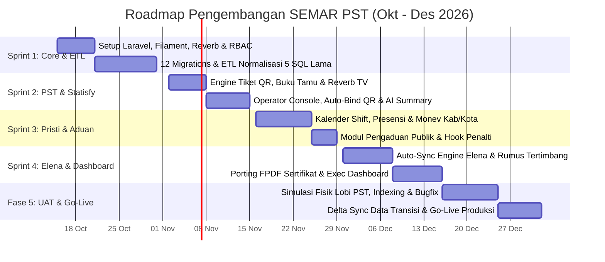

# ROADMAP & BACKEND KANBAN BACKLOG
## SEMAR PST — Eksekusi Teknis Backend Engineer
**Periode Pengerjaan:** 15 Oktober 2026 – 31 Desember 2026 (11 Minggu)  
**Target Feature Complete:** 15 Desember 2026 (9 Minggu Pengembangan Aktif)  
**Target UAT & Production Go-Live:** 16 Desember – 31 Desember 2026 (2 Minggu Buffer & Cut-Over)  
**Proporsi Beban Kerja:** Backend 70% (Laravel 12, Filament v3, ETL SQL, Services, Reverb) | Frontend 30% (Livewire Public Views)

---

## 1. Roadmap Mingguan (15 Oktober – 31 Desember 2026)

| Sprint / Fase | Rentang Waktu | Fokus Milestone | Deliverable Utama Backend |
| :--- | :--- | :--- | :--- |
| **Sprint 1** | **15 Okt – 30 Okt 2026** | Pondasi Laravel 12, Skema 12 Tabel, SSO RBAC, & ETL 5 Database Lama. | • Setup Laravel + Filament v3 + Reverb + Shield. • 12 Migration files + Foreign Keys. • Artisan Command `semar:etl-*` (pemetaan `nama_pegawai` ke `nip_baru`). |
| **Sprint 2** | **2 Nov – 13 Nov 2026** | Operasional Antrian PST, WebSocket TV, Konsol Loket, & Dual-QR Statisfy. | • `TicketQueueService` + Buku Tamu auto-lookup. • Event Reverb TV & `OperatorConsole` 1-layar. • Resolver *auto-bind* QR Plakat Meja & Job AI Summary. |
| **Sprint 3** | **16 Nov – 27 Nov 2026** | Kalender Jadwal Shift, Presensi, Laporan Monev Kab/Kota, & Pengaduan. | • Filament Resource Jadwal + Import/Export Excel Pristi. • Auto check-in presensi dari Konsol Loket. • Engine Monev Kab/Kota (Bulan/Triwulan/Semester) & Modul Aduan. |
| **Sprint 4** | **30 Nov – 15 Des 2026** | Otomatisasi Skor Elena, Cetak Sertifikat FPDF, & **100% Feature Complete**. | • `ElenaCalculationService` (Auto-sync PST, Pristi, Statisfy, Aduan). • Porting koordinat PDF `Sertifikat.php` & `LaporanFpdf.php`[cite: 1]. • Query agregasi *Executive Dashboard* & Leaderboard. |
| **Fase 5** | **16 Des – 31 Des 2026** | UAT Lobi Fisik, Optimasi Query, Delta Data Sync, & Rilis Produksi. | • Stress test WebSocket & optimasi *composite index* SQL. • Sinkronisasi selisih data transaksi Oktober–Desember. • Cut-over domain utama ke server **SEMAR PST**. |

---

## 2. Kanban Backlog — Backend Engineering (35 Tiket Terukur)

Keterangan Estimasi **Story Points (SP)**: `1 SP` = ±2–3 Jam | `2 SP` = ±1 Hari | `3 SP` = ±1,5–2 Hari | `5 SP` = ±3 Hari | `8 SP` = ±4–5 Hari.

### EPIC 1: Core Architecture, Database & Legacy Data ETL (15 Okt – 30 Okt 2026)
*Target: Menyatukan 5 database lama (`jatengwe_apps.sql`, `pengaduan_jateng.sql`, `pristi_db_new (2).sql`, `pst_db.sql`, `statisfy.sql`) menjadi 1 skema bersih[cite: 1].*

| ID Tiket | Nama Task Backend | Prioritas | SP | Kriteria Selesai (Definition of Done) |
| :--- | :--- | :---: | :-: | :--- |
| **BE-01** | Inisialisasi Project & Package Utama | `P0 - Critical` | 2 | Install Laravel 11/12, FilamentPHP v3, Livewire 3, Laravel Reverb, `spatie/laravel-permission`, `filament-shield`, `maatwebsite/laravel-excel`, `simplesoftwareio/simple-qrcode`, dan `setasign/fpdf`. |
| **BE-02** | Migration Master Pegawai (`users`) & Loket (`pst_counters`) | `P0 - Critical` | 3 | Buat skema `users` yang melebur kolom `dash_pegawai` (`niplama`, `nipbaru`, `no_wa`, `id_wilayah`, `id_unitkerja`, `eselon`), `elena_m_petugas` (`kode_tim`, `nama_tim`, `kodehitung`), dan `skm_petugas_pst` (`nama_tanpagelar`)[cite: 1]. |
| **BE-03** | Migration Transaksi PST & Statisfy (5 Tabel) | `P0 - Critical` | 3 | Buat migration untuk `pst_visitors` (eks-`pst_buku_tamu`), `pst_visitor_logs` (eks-`pst_kunjungan_tamu`), `pst_service_tickets` (gabungan `pst_tiket`, `pst_register`, `pst_layanan`), `statisfy_surveys`, dan `statisfy_ai_analyses`[cite: 1]. |
| **BE-04** | Migration Transaksi Pristi, Aduan & Elena (5 Tabel) | `P0 - Critical` | 3 | Buat migration untuk `pristi_schedules`, `pristi_attendances`, `pristi_monev_reports`, `public_complaints` (gabungan `t_pengaduan` & `kandani_t_pengaduan`), dan `elena_evaluations` (eks-`elena_t_lk`)[cite: 1]. |
| **BE-05** | Konfigurasi SSO & Multi-Role RBAC | `P0 - Critical` | 3 | Buat Seeder 6 Role (`super_admin`, `operator_pst`, `admin_pristi`, `admin_pengaduan`, `admin_elena`, `eksekutif`) dan pasang Filament Shield Policy di setiap modul. |
| **BE-06** | ETL Script 1: Deduplikasi Master Pegawai | `P0 - Critical` | 5 | Buat Artisan Command `php artisan semar:etl-users` untuk mengimpor pegawai dari `dash_pegawai` (`elena` & `pristi`), lalu memperkaya datanya dari `elena_m_petugas`, `t_pengaduan_admin`, dan `skm_petugas_pst` berdasarkan `nipbaru`[cite: 1]. |
| **BE-07** | ETL Script 2: Normalisasi Nama Pegawai ke NIP | `P0 - Critical` | 8 | Buat *mapper script* untuk mencocokkan kolom teks `nama_pegawai` (`varchar(50)`) di tabel-tabel `elena` dan `created_by` (`varchar(64)`) di `pst_layanan`/`pst_register`[cite: 1] ke `users.id` agar data historis tidak yatim (*orphan*). |
| **BE-08** | ETL Script 3: Migrasi Histori Transaksi 5 DB | `P1 - High` | 5 | Impor histori kunjungan, layanan PST, survei `skm_survei`/`skm_kepuasan`, pengaduan `t_pengaduan`, dan nilai `elena_t_lk`[cite: 1] ke tabel baru. |

---

### EPIC 2: Modul Operasional PST & Real-Time Queue (2 Nov – 8 Nov 2026)
*Target: Menggantikan logika `Tiket.php`, `Bukutamu.php`, `Antrian.php`, dan `Operator.php` dari sistem `pst`[cite: 1].*

| ID Tiket | Nama Task Backend | Prioritas | SP | Kriteria Selesai (Definition of Done) |
| :--- | :--- | :---: | :-: | :--- |
| **BE-09** | Service Generator Tiket & Dynamic QR Token | `P0 - Critical` | 3 | Buat `TicketQueueService` untuk mereset nomor urut harian per tanggal, men-generate UUID/Hash pendek di `qr_token`, dan menyimpan kategori (`perpustakaan`, `konsultasi`, `pembelian`, `rekomendasi`)[cite: 1]. |
| **BE-10** | Backend Buku Tamu Auto-Lookup & Check-Out | `P1 - High` | 2 | Porting logika `M_tamu::get_by_hp`, `insert_buku_tamu`, `insert_kunjungan`, dan `set_pulang`[cite: 1] ke Eloquent `PstVisitor` & `PstVisitorLog` dengan indeks pencarian cepat pada `phone_number`. |
| **BE-11** | WebSocket Broadcasting (Laravel Reverb) untuk TV | `P0 - Critical` | 5 | Buat Event `QueueTicketCalled` dan `QueueStateUpdated` untuk menggantikan *polling* lama `Antrian::json`[cite: 1]. Kirim payload nomor tiket, nama loket, dan teks *phonetic* Bahasa Indonesia ke channel TV. |
| **BE-12** | Backend `OperatorConsole` (1-Screen Workflow) | `P0 - Critical` | 5 | Gabungkan proses `Operator::register_start` dan `Operator::layanan_start`[cite: 1] menjadi 1 siklus state (`waiting` -> `called` -> `serving` -> `completed`/`skipped`) lengkap dengan pencatatan `started_at` dan `finished_at`. |
| **BE-13** | Fitur Sisip Antrian Manual (`sisip`) | `P2 - Medium` | 2 | Porting fungsi `Operator::sisip`[cite: 1] agar operator dapat menyisipkan tamu prioritas/khusus ke dalam antrian aktif tanpa merusak urutan nomor tiket reguler. |

---

### EPIC 3: Modul Statisfy 15-Second Survey & AI Analytics (9 Nov – 15 Nov 2026)
*Target: Menggantikan `Survey.php`, `KepuasanPetugas.php`, dan `Analisis.php` dari sistem `statisfy` serta `pst_penilaian`[cite: 1].*

| ID Tiket | Nama Task Backend | Prioritas | SP | Kriteria Selesai (Definition of Done) |
| :--- | :--- | :---: | :-: | :--- |
| **BE-14** | Resolver QR Struk Tiket (`/s/{qr_token}`) | `P0 - Critical` | 2 | Buat endpoint & validasi token yang mengembalikan data `PstServiceTicket` beserta relasi profil petugas (`served_by_user_id`) dan mencegah pengisian ganda jika `survey` sudah terisi. |
| **BE-15** | Smart Auto-Bind QR Plakat Meja (`/loket/{slug}/survei`) | `P0 - Critical` | 5 | Buat query *session-binding* yang menarik transaksi terakhir di meja loket tersebut yang berstatus `completed` atau `serving` dalam 15 menit terakhir dan belum memiliki record di `statisfy_surveys`. |
| **BE-16** | Endpoint Submit Survei Offline & Online | `P0 - Critical` | 3 | Simpan rating (`rating_score`), `feedback_comment`, `media_channel`, dan `remote_ip`[cite: 1]. Kunci transaksi tiket dan picu *cache invalidation* pada statistik harian petugas. |
| **BE-17** | Query Agregasi Statistik & Ranking Petugas | `P1 - High` | 3 | Porting method `SurveyModel` (`getStatistik`, `getTrenKepuasan`, `getDistribusiMedia`, `getDistribusiLayanan`) dan `KepuasanPetugas` (`exportRank`, `exportDetail`, `exportAllDetail`)[cite: 1] ke Eloquent & Laravel-Excel. |
| **BE-18** | Queue Job Integrasi AI Summary (`statisfy_ai_analyses`) | `P2 - Medium` | 5 | Porting fungsi `Analisis::proses` dan `AnalisisModel::getAnalisis` (`bulanan`, `tahunan`, `alltime`)[cite: 1] menggunakan Laravel Queue Job ke API Gemini/OpenAI agar halaman admin tidak *timeout*. |

---

### EPIC 4: Modul Pristi (Jadwal, Presensi & Monev Kab/Kota) (16 Nov – 24 Nov 2026)
*Target: Menggantikan `Jadwal.php`, `Pristi.php`, `Report.php`, dan `provinsi.php` dari sistem `pristi`[cite: 1].*

| ID Tiket | Nama Task Backend | Prioritas | SP | Kriteria Selesai (Definition of Done) |
| :--- | :--- | :---: | :-: | :--- |
| **BE-19** | CRUD Kalender Jadwal & Tukar Shift (`pristi_schedules`) | `P1 - High` | 3 | Porting logika `Jadwal.php` dan `Mycal_model.php`[cite: 1] ke Filament Resource. Sediakan API/hook untuk mendeteksi siapa petugas yang terjadwal di loket pada hari berjalan. |
| **BE-20** | Import/Export Template Jadwal & Perubahan | `P1 - High` | 3 | Porting fungsi `download_template`, `import`, `download_template_perubahan`, dan `importperubahan`[cite: 1] menggunakan class `Laravel-Excel`. |
| **BE-21** | Engine Presensi Petugas & Kalkulasi Keterlambatan | `P0 - Critical` | 5 | Porting fungsi `simpanpresensi`, `simpandatamanual`, dan `upload`[cite: 1]. Hitung otomatis kolom `time_difference` (`selisih` antara jam standar shift dan `check_in_time`)[cite: 1] serta hubungkan dengan login `OperatorConsole`. |
| **BE-22** | Backend Evaluasi Monev Kab/Kota (9 Dimensi) | `P1 - High` | 5 | Porting fungsi `provinsi.php` & `Pristi.php` untuk input dan `updatenilai` / `updatestatus` pada dimensi `adm`, `teknis`, `sdm`, `korupsi`, `prof`, `sarpras`, `sipp`, `pengaduan`, dan `inovasi` lintas wilayah (`rekapkabkot`)[cite: 1]. |
| **BE-23** | Generator Export Excel Laporan Berjenjang Pristi | `P1 - High` | 5 | Buat class Export Excel untuk menggantikan `exportrekapkehadiran`, `exportrekapbulanan`, `exportrekaprealisasi`, `exportreportbulan`, `exportreporttriwulan`, dan `exportreportsemester`[cite: 1]. |

---

### EPIC 5: Modul Layanan Pengaduan & Whistleblowing (25 Nov – 27 Nov 2026)
*Target: Menyatukan `pengaduan.jateng.pro` (`t_pengaduan`) dan modul aduan `pristi` (`kandani_t_pengaduan`)[cite: 1].*

| ID Tiket | Nama Task Backend | Prioritas | SP | Kriteria Selesai (Definition of Done) |
| :--- | :--- | :---: | :-: | :--- |
| **BE-24** | Backend Tiket Aduan & Generator Tracking Code | `P1 - High` | 2 | Buat endpoint penyimpanan aduan masyarakat (`reporter_name`, `reporter_email`, `reporter_phone`, `complaint_category`, `complaint_content`, `remote_ip`)[cite: 1] beserta generator kode unik `ADU-YYYY-XXXX`. |
| **BE-25** | Workflow Tindak Lanjut, Feedback & Hook Penalti Elena | `P1 - High` | 3 | Gabungkan fitur `inputfeedback` (`pengaduan.jateng.pro`) dan `inputtindaklanjut` (`pristi`) di Filament Resource. Tambahkan relasi `related_user_id` dan flag `is_valid_penalty` untuk mengalirkan komplain valid ke variabel pengurang nilai petugas di modul Elena. |

---

### EPIC 6: Modul Evaluasi Kinerja Elena & Sertifikat FPDF (30 Nov – 15 Des 2026)
*Target: Menggantikan `Kinerja.php`, `Evaluasi.php`, `Sertifikat.php`, dan `Laporan.php` dari sistem `elena`.*

| ID Tiket | Nama Task Backend | Prioritas | SP | Kriteria Selesai (Definition of Done) |
| :--- | :--- | :---: | :-: | :--- |
| **BE-26** | Engine Agregasi Otomatis Elena (`ElenaCalculationService`) | `P0 - Critical` | 5 | Buat service untuk menghitung otomatis agregat bulanan per `user_id`: volume layanan dari `pst_service_tickets`, skor kehadiran dari `pristi_attendances`, rerata kepuasan dari `statisfy_surveys`, dan penalti dari `public_complaints` tanpa upload Excel manual. |
| **BE-27** | Kalkulasi Skor Tertimbang & Input Nilai Kualitatif | `P0 - Critical` | 5 | Sediakan form penilaian perilaku/inovasi/penampilan dan implementasikan formula tertimbang (`_ttb`) berbasis `elena_calc_code` (`kodehitung`) untuk menghasilkan `total_score`, `eval_score`, dan peringkat (`rank_position`). |
| **BE-28** | Mekanisme Kunci Hasil Evaluasi & Leaderboard Publik | `P1 - High` | 3 | Buat workflow *Lock Result* (`is_locked`) yang membekukan data nilai periode berjalan, mempublikasikan pemenang ke Leaderboard publik, dan mengunci perubahan dari tim penilai. |
| **BE-29** | Porting Generator Piagam Penghargaan FPDF (`Sertifikat.php`) | `P1 - High` | 3 | Porting class FPDF untuk mencetak piagam penghargaan petugas teladan dengan koordinat presisi eksisting, QR code verifikasi keaslian, dan stempel dinamis. |
| **BE-30** | Porting Generator Laporan Evaluasi Bulanan FPDF (`LaporanFpdf.php`) | `P1 - High` | 3 | Porting template rekapitulasi penilaian bulanan/tahunan berformat tabel matriks FPDF lengkap dengan tanda tangan digital koordinator PST. |
| **BE-31** | Executive Dashboard & Rekapitulasi Lintas Modul | `P1 - High` | 5 | Buat Filament Dashboard khusus pimpinan/eksekutif dengan widget tren kunjungan PST, indeks kepuasan Statisfy, persentase kehadiran Pristi, dan status tindak lanjut aduan secara real-time. |

---

### EPIC 7: UAT, Optimasi Sistem & Rilis Produksi (16 Des – 31 Des 2026)
*Target: Memastikan performa tinggi, zero-downtime, dan migrasi transisi mulus.*

| ID Tiket | Nama Task Backend | Prioritas | SP | Kriteria Selesai (Definition of Done) |
| :--- | :--- | :---: | :-: | :--- |
| **BE-32** | Stress Testing WebSocket Reverb & Simulasi Antrian Lobi | `P1 - High` | 3 | Lakukan pengujian beban koneksi WebSocket TV display dan konsol loket simultan, validasi reconnect otomatis saat sinyal drop, dan respons audio TTS Web Speech. |
| **BE-33** | Optimasi Composite Index & Query Tuning 12 Tabel | `P0 - Critical` | 3 | Pasang *composite index* strategis pada kolom pencarian frekuensi tinggi (`phone_number`, `qr_token`, `service_date`, `user_id + period`) dan verifikasi EXPLAIN query < 50ms. |
| **BE-34** | Delta Sync ETL Data Transisi Periode Oktober–Desember | `P0 - Critical` | 5 | Eksekusi sinkronisasi delta untuk menyedot data transaksi baru yang tercatat di 5 aplikasi lama selama fase pengembangan berjalan sebelum cut-over. |
| **BE-35** | Cut-Over Server, Security Hardening & Go-Live SEMAR PST | `P0 - Critical` | 3 | Konfigurasi production environment (Nginx/HTTPS, supervisor worker Reverb & Queue, failover), backup final database lama, dan *switchover* domain utama ke sistem SEMAR PST. |